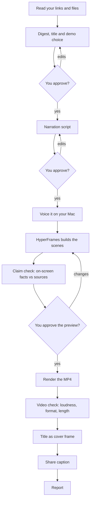

# Spec Reel


A Claude Code skill that turns links to plans and specs into a short narrated explainer video.

You give it one or more links or files. It reads them, writes a digest of why each plan exists, what it changes and what comes next, and writes a timestamped narration script. You approve both. It voices the script on your Mac with [Qwen3-TTS](https://huggingface.co/Qwen/Qwen3-TTS-12Hz-1.7B-CustomVoice) through [MLX-Audio](https://github.com/Blaizzy/mlx-audio), or takes audio you make with any text-to-speech tool you choose. Then it hands scene building to the HyperFrames `faceless-explainer` workflow, which builds scenes synced to the narration and renders an MP4.

Every video opens with an intro scene: the approved title on screen, narrated by one short sentence on what the video is about. When the feature can be shown, a demo scene shows it: a mock or a screen recording found in your sources or given by you. You can skip the demo.

Stages: sources, digest, title and demo (you approve), script (you approve), voicing, frame plan (you approve), sketches (you approve), claim check, preview (you approve), render, video check, cover frame and caption. With `--yolo`, the skill makes every approval itself (see [First run](#first-run)).



With `--yolo`, every "You approve?" step is decided by the skill and listed in the report.

Every run has its own folder with a `RUN.md` that records the stage and each approval, so an interrupted run can be resumed.

## Prerequisites

- Claude Code
- The HyperFrames skills, including `faceless-explainer`: `npx hyperframes skills`
- Node.js with `npx`
- Python 3.10 or later
- `ffmpeg` and `ffprobe` on your path
- For the default voice: an Apple Silicon Mac and [`uv`](https://docs.astral.sh/uv/). The skill runs Qwen3-TTS with `uv run --with mlx-audio`, so there is nothing else to install; the model (about 4 GB) downloads on first use. On other machines, use your own engine.
- Optional: the GitHub CLI (`gh`), signed in, to read GitHub links

## Install

Clone it into your skills folder:

```bash
git clone https://github.com/borisd9/spec-reel.git ~/.claude/skills/spec-reel
```

Or clone it somewhere else and link it:

```bash
git clone https://github.com/borisd9/spec-reel.git ~/skills/spec-reel
ln -s ~/skills/spec-reel ~/.claude/skills/spec-reel
```

Start a new Claude Code session. `spec-reel` appears in the skill list.

To update later, pull in the folder you cloned: `git -C ~/.claude/skills/spec-reel pull` (or `~/skills/spec-reel` for a linked clone).

## Configure

```bash
cp config.example.json config.json
```

`config.json` is ignored by git. The skill creates it and asks for any missing value on the first run, so this step is optional.

| Field | Meaning |
|---|---|
| `output_root` | Where run folders go. Default `~/Movies/hyperframes`. |
| `style_preset` | The faceless-explainer look. Default `blue-professional`. |
| `voice_source` | `qwen` (Qwen3-TTS on your Mac, default) or `own` (your own engine). |
| `qwen_speaker` | `Aiden` (default) or `Ryan`, the two English voices. |
| `qwen_instruct` | A style instruction for Qwen3-TTS. Empty means a calm, conversational narrator. |
| `tts_command` | Default command for your own engine. Empty means you drop audio files. |
| `slide_pause_s` | Seconds of silence after every line but the last. Default `1.0`. |
| `captions` | `off` (default) or `on`. |
| `pronunciations` | Respellings for Qwen3-TTS, for example `{"KBs": "K-Bs"}`. Default `{}`. |

## Voice sources

**Qwen3-TTS** (default). Runs locally through MLX-Audio, so the script text never leaves your machine. Model: `mlx-community/Qwen3-TTS-12Hz-1.7B-CustomVoice-bf16` (Apache-2.0). On an Apple Silicon Mac it generates speech faster than real time: about a minute for 90 seconds of narration, after the first model load. To voice a script by hand:

```bash
uv run --python 3.11 --with mlx-audio==0.6.1 --with soundfile \
  python scripts/qwen_voice.py <run folder> --speaker Aiden
```

**Your own engine.** The skill lists every script line with its frame number and a target file name, `voice-in/NN.<ext>`. Either drop one audio file per line (WAV, MP3, M4A or AIFF), or give a command and the skill runs it once per line. In a command, `{text_file}` is a temp file holding the line's text and `{out}` is `voice-in/NN` with no extension; the command supplies its own extension:

```bash
say -v Samantha -f {text_file} -o {out}.aiff
```

The spoken text reaches the command only through `{text_file}`. A command never contains a credential: if your tool needs a key, the command reads it from an environment variable or a file outside this folder. The skill refuses to save a command that contains a key.

`scripts/adopt_voice.py` then converts the files to WAV, gets word timings with `npx hyperframes transcribe`, and writes the audio metadata faceless-explainer reads. It keeps the script's own words on the transcript timings and reports lines that were heard differently (`--check-speech`). Changing one line means replacing one file and running it again.

## First run

In Claude Code:

```text
/spec-reel https://example.com/plan ~/plans/feature-spec.md
```

For a run with no questions at all, add `--yolo`:

```text
/spec-reel --yolo https://example.com/plan ~/plans/feature-spec.md
```

It uses the defaults (a team update, about 75 seconds, the configured voice), decides every review itself, renders the MP4, and ends with a list of everything it decided without you. It never posts or shares the video. Claude Code may still ask permission to run commands (`npx`, `ffmpeg`, `uv`, `curl`, `gh`) unless your permission mode allows them.

Without `--yolo`, the skill asks, in one batch: the links or files, the audience and intent, the target length (default 60-90 seconds) and the voice source. Then approve the digest, approve the script, and review the frame plan, the sketch board and the preview. Before the preview, the skill checks that every name, number and capability shown on screen comes from your sources.

After the render, `scripts/qc_video.py` normalizes the loudness to -16 LUFS and checks the MP4's format, audio, black spans and length.

Inside the run folder, `renders/` then holds:

- `video.mp4`, whose first frame is the intro title, so chat apps show it as the thumbnail;
- `cover.jpg`, that same frame, for platforms that take a separate thumbnail;
- `share-copy.txt`, a one-to-three-sentence caption to post with the video.

## Tests

```bash
python3 -I -m unittest discover -s scripts -p 'test_*.py' -v
```

The tests use fakes for ffmpeg, ffprobe, transcription and the Qwen3-TTS model, so they need none of them. `scripts/test_skill_structure.py` also checks that the documents agree: every named file and link exists, the delta line and delta count match across `SKILL.md` and `references/handoff.md`, and `config.example.json` matches the table above.

Every pull request runs `.github/workflows/checks.yml`: these tests on Linux and macOS, `ruff`, a gitleaks secret scan, and a scan for names the repository keeps private (its word list is a repository secret, so pull requests from forks skip it).

## Credits

The cover frame, the share caption and the on-screen claim check are adapted from [brag](https://github.com/latent-spaces/brag) by Shunit Haviv Hakimi (MIT).

Change-line, style and scene-card rules adapted from [marketingskills](https://github.com/coreyhaines31/marketingskills) (MIT, Corey Haines) and [story-skills](https://github.com/danjdewhurst/story-skills) (MIT).

## License

MIT, see [LICENSE](LICENSE). The Qwen3-TTS model it downloads is Apache-2.0.
